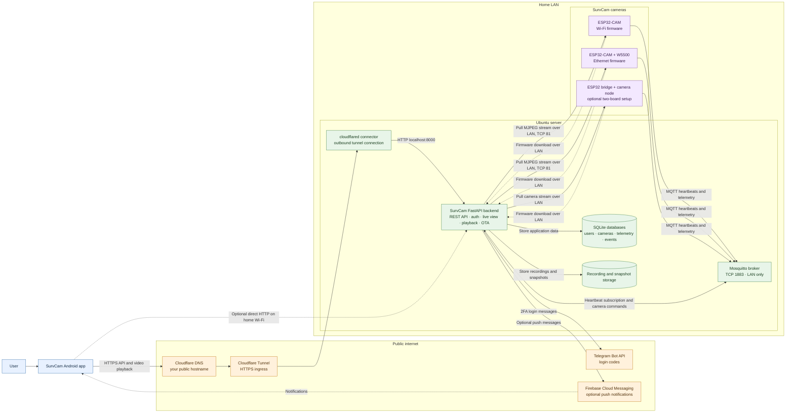

# SurvCam architecture

This diagram shows the normal traffic paths for a self-hosted installation. Replace the example hostname and LAN address with the values configured for your own server.

## Network boundaries

- The Android app reaches the backend over HTTPS through Cloudflare when away from home. On home Wi-Fi it can use the server's LAN address directly.
- `cloudflared` makes an outbound connection to Cloudflare and forwards the public hostname to the local backend. A router port-forward is not needed.
- Cameras use the server's LAN address for MQTT, video, and firmware downloads. Cloudflare Tunnel is not the MQTT path.
- Keep MQTT port `1883` on the home LAN. Do not forward it from the router or publish it as a Cloudflare public hostname.
- Telegram 2FA is required by the backend. Firebase push notifications are optional and require each installer to provide their own Firebase configuration.
